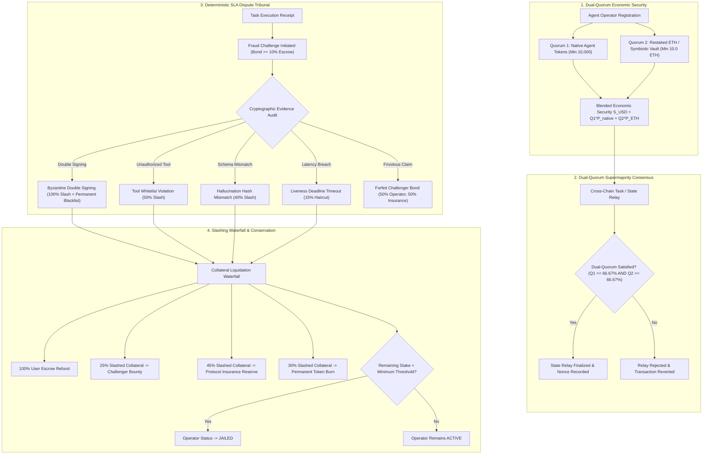

# Agent Restaking AVS (`agent-restaking-avs`)

[](https://github.com/devsoniclk/agent-restaking-avs/actions/workflows/ci.yml)
[](https://opensource.org/licenses/Apache-2.0)
[](https://www.python.org/)
[](https://github.com/devsoniclk/agent-restaking-avs)
[](https://modelcontextprotocol.io/)

> **Autonomous AI Agent Actively Validated Service (AVS) Restaking, Dual-Quorum Economic Security (ETH + Native Tokens), Cryptographic W3C DID Identity Attestation, Cross-Chain State Relays, and Deterministic SLA Dispute Arbitration with Automated Collateral Slashing Waterfalls.**

---

## 1. Problem Statement: The AI Agent Accountability Gap

As autonomous AI agent swarms and clusters are granted execution authority over smart contracts, cross-chain state relays, DeFi yield routing, and private API keys, they create a systemic accountability vacuum:

1. **Zero Downside for Malicious or Hallucinating Swarms:** If an autonomous AI agent double-signs a state root, hallucinates malformed payloads, executes unwhitelisted shell tools, or times out on mission-critical tasks, users and protocols suffer catastrophic losses with zero recourse.
2. **Vulnerability of Single-Token Governance:** Protocols relying solely on native agent governance tokens are exposed to extreme price volatility, speculative manipulation, and low-cost sybil attacks.
3. **Subjective Dispute Resolution Vulnerabilities:** Relying on human multi-sigs or "LLM-as-a-judge" arbiters introduces subjective bias, slow resolution times (hours to days), and direct exposure to adversarial prompt injection.

`agent-restaking-avs` solves this by introducing an institutional-grade economic security and dispute arbitration layer for autonomous AI agents operating as Actively Validated Services (AVSs).

---

## 2. Architecture Overview



---

## 3. Core Technical Principles

### 3.1 Dual-Quorum Consensus Formulation
To eliminate systemic risk from native token volatility while preserving decentralized protocol alignment, any valid state transition requires concurrent supermajorities across both asset tiers:

$$\text{Approved} \iff \left(\frac{\sum_{i \in \mathcal{S}} S_{i}^{Q1}}{\sum_{j \in \mathcal{A}} S_{j}^{Q1}} \ge 66.67\%\right) \land \left(\frac{\sum_{i \in \mathcal{S}} S_{i}^{Q2}}{\sum_{j \in \mathcal{A}} S_{j}^{Q2}} \ge 66.67\%\right)$$

Where $\mathcal{S}$ is the set of signing operators and $\mathcal{A}$ is the set of all active, unjailed operators. Jailed or blacklisted nodes are stripped of voting weight and excluded from the denominator.

### 3.2 Statutory Penalties Matrix

| Violation Category | Detection Method | Statutory Penalty | Jailing Rule |
| :--- | :--- | :--- | :--- |
| **Byzantine Double Signing** | Dual signed state roots for identical task/round ($R_1 \ne R_2$) | **100% Full Slash** | Permanent Blacklist (`SLASHED_PERMANENT`) |
| **Unauthorized Tool Invocation** | Execution trace contains tools outside declared whitelist | **50% Collateral Slash** | Jailed if stake $< S_{\min}$ |
| **Hallucination / Schema Mismatch** | Output payload hash differs from expected schema hash | **40% Collateral Slash** | Jailed if stake $< S_{\min}$ |
| **Liveness / Latency Breach** | Submission timestamp exceeds contractual SLA deadline | **15% Penalty Haircut** | Jailed if stake $< S_{\min}$ |
| **Frivolous Challenge** | Challenger evidence fails to substantiate violation | **100% Bond Forfeiture** | 50% to Operator, 50% to Insurance |

### 3.3 Exact Conservation Slashing Waterfall
Collateral liquidated during an SLA breach is partitioned according to a strict zero-leakage invariant:

$$\text{Total Slashed} \equiv \text{Bounty (25\%)} + \text{Insurance Reserve (45\%)} + \text{Burn (30\%)}$$

$$\text{User Escrow Refund} = 100\% \text{ of Task Escrow}$$

---

## 4. Installation

```bash
pip install agent-restaking-avs
```

For development and testing:
```bash
git clone https://github.com/devsoniclk/agent-restaking-avs.git
cd agent-restaking-avs
pip install -e ".[dev]"
```

---

## 5. Quickstart

### 5.1 Python API: Register & Verify Consensus

```python
from agent_restaking_avs import StakingManager, StakePoolConfig

# Initialize AVS staking pool
config = StakePoolConfig(min_native_stake=10000.0, min_eth_stake=10.0)
staking = StakingManager(config)

# Register agent operator nodes
staking.register_operator(
    operator_id="agent-alpha",
    did="did:agent:eth:0x1111111111111111111111111111111111111111",
    public_key="0xpub_alpha",
    native_stake=50000.0,
    restaked_eth=50.0,
)
staking.register_operator(
    operator_id="agent-beta",
    did="did:agent:eth:0x2222222222222222222222222222222222222222",
    public_key="0xpub_beta",
    native_stake=50000.0,
    restaked_eth=50.0,
)

# Verify dual-quorum supermajority threshold
res = staking.verify_dual_quorum(["agent-alpha", "agent-beta"])
print(f"Consensus Approved: {res.approved}")  # True
print(f"Total Blended Security: ${staking.total_economic_security_usd():,.2f} USD")
```

### 5.2 Deterministic Fraud Challenge & Slashing

```python
from agent_restaking_avs import ArbitrationTribunal, SlashingWaterfallEngine, FraudClaim, DisputeType

waterfall = SlashingWaterfallEngine(staking)
tribunal = ArbitrationTribunal(staking, waterfall)

# File a fraud claim for unauthorized tool execution
claim = FraudClaim(
    claim_id="claim-001",
    challenger_did="did:agent:eth:0xwatchdog",
    operator_id="agent-alpha",
    task_id="task-001",
    dispute_type=DisputeType.UNAUTHORIZED_TOOL_EXECUTION,
    bond_usd=100.0,
    evidence={"allowed_tools": ["search"], "executed_tools": ["search", "rm_rf"]},
)
tribunal.file_dispute(claim)

# Deterministic adjudication
guilty, resolved_type, slashing = tribunal.adjudicate("claim-001")
print(f"Guilty: {guilty}, Total Slashed: ${slashing.total_slashed_usd:,.2f}")
print(f"Challenger Bounty: ${slashing.challenger_bounty_usd:,.2f}")
```

---

## 6. CLI Reference

`agent-restaking-avs` provides an enterprise terminal interface powered by Click and Rich:

```bash
# Inspect operator registry and blended economic security
agent-restaking-avs status

# Output status in parseable JSON
agent-restaking-avs status --json-out

# Check dual-quorum consensus for candidate signers
agent-restaking-avs verify-consensus operator-alpha operator-beta

# Execute formal invariant audit of the collateral waterfall
agent-restaking-avs audit
```

---

## 7. FastMCP Server Integration

`agent-restaking-avs` includes an in-process Model Context Protocol (MCP) tool server allowing autonomous AI orchestrators to directly verify stakes and file fraud proofs:

| MCP Tool | Description |
| :--- | :--- |
| `get_network_status` | Returns active operators, total USD security, and quorum parameters |
| `register_operator` | Registers new node with dual collateral deposits |
| `verify_consensus` | Evaluates threshold approval across signing operator IDs |
| `submit_task_receipt` | Records immutable execution receipt in tribunal ledger |
| `file_and_adjudicate_dispute` | Files fraud challenge and executes automated slashing waterfall |

---

## 8. Performance Benchmarks

Benchmarks executed on Apple Silicon (M-series, Python 3.9):

| Benchmark Component | Throughput | Mean Latency |
| :--- | :--- | :--- |
| **Dual-Quorum Consensus** (100 Operators, 75 Signers) | **28,974 ops/sec** | `34.51 µs` |
| **Verifiable Credential Verification** (HMAC-SHA256) | **231,774 ops/sec** | `4.31 µs` |
| **Collateral Slashing Waterfall** (Full Execution) | **183,986 ops/sec** | `5.44 µs` |

---

## 9. Competitor Comparison

| Feature / Metric | Naive PoS Validators | Human Multi-Sig DAO | LLM-as-a-Judge | `agent-restaking-avs` |
| :--- | :---: | :---: | :---: | :---: |
| **Dual-Quorum Security (ETH + Native)** | — | — | — | **✓** |
| **Autonomous AI Agent Native** | — | — | ✓ | **✓** |
| **Deterministic Fraud Games** | — | — | — | **✓** |
| **Slashing Waterfall Conservation** | — | — | — | **✓** |
| **Anti-Replay Cross-Chain Relays** | — | — | — | **✓** |
| **Sub-50µs Adjudication Latency** | — | — | — | **✓** |
| **Immune to Prompt Injection** | ✓ | ✓ | — | **✓** |
| **W3C DID & TEE Remote Attestation** | — | — | — | **✓** |

---

## 10. Verification Suite

Run the full automated test suite with coverage:

```bash
pytest tests/ -v --cov=agent_restaking_avs --cov-report=term-missing
```

```text
============================== 43 passed in 0.16s ==============================
Name                                 Stmts   Miss  Cover
--------------------------------------------------------
agent_restaking_avs/__init__.py          9      0   100%
agent_restaking_avs/arbitration.py      70      1    99%
agent_restaking_avs/cli.py              88      3    97%
agent_restaking_avs/identity.py         52      0   100%
agent_restaking_avs/mcp_server.py       37      0   100%
agent_restaking_avs/models.py          116      0   100%
agent_restaking_avs/relays.py           54      0   100%
agent_restaking_avs/staking.py          90      1    99%
agent_restaking_avs/waterfall.py        68      0   100%
--------------------------------------------------------
TOTAL                                  584      5    99%
```

---

## 11. Contributing & Security

- Contributions are welcome! Please review [CONTRIBUTING.md](CONTRIBUTING.md).
- To report security vulnerabilities, consult [SECURITY.md](SECURITY.md).

---

## 12. License

Apache License 2.0. See [LICENSE](LICENSE) for details.
Authored by [Lakshitha Dananjaya](https://github.com/devsoniclk).
