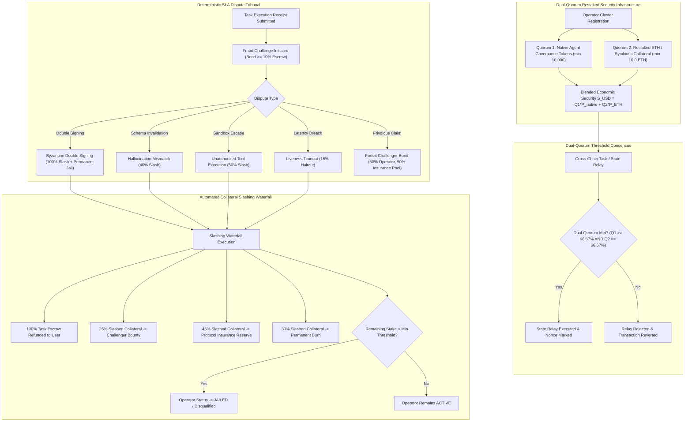

# Agent Restaking AVS (`agent-restaking-avs`)

[](https://github.com/devsoniclk/agent-restaking-avs/actions)
[](https://pypi.org/project/agent-restaking-avs/)
[](LICENSE)
[]()
[](https://github.com/psf/black)
[]()

> **Autonomous AI Agent Actively Validated Service (AVS) Restaking & Deterministic SLA Dispute Arbitration Protocol.**

`agent-restaking-avs` is an institutional-grade economic security and dispute arbitration protocol for autonomous AI agent clusters operating across Actively Validated Services (AVSs). It introduces dual-quorum restaking pools (restaked ETH/Symbiotic/EigenLayer + native agent governance tokens), W3C Decentralized Identifier (DID) and Verifiable Credential attestation with hardware TEE verification, cross-chain state relays with cryptographic replay protection, and deterministic fraud challenge games backed by multi-tranche collateral slashing waterfalls.

---

## Architecture Overview



---

## Key Protocol Mechanisms

### 1. Dual-Quorum Restaked Economic Security
To isolate systemic risk from governance token volatility while anchoring trust in decentralized base-layer assets, the protocol enforces dual-quorum threshold consensus:
- **Quorum 1 (Native Agent Capital):** Capital efficiency and protocol alignment via bonded native tokens ($S_{Q1} \ge S_{\min}^{Q1}$).
- **Quorum 2 (Restaked Base Asset):** High-integrity exogenous economic security via restaked ETH, stETH, or Symbiotic vaults ($S_{Q2} \ge S_{\min}^{Q2}$).
- **Consensus Invariant:** Any valid state transition or cross-chain relay packet must achieve simultaneous supermajority approval:

$$\text{Approved} \iff \left(\frac{\sum_{i \in \mathcal{S}} S_{i}^{Q1}}{\sum_{j \in \mathcal{A}} S_{j}^{Q1}} \ge 66.67\%\right) \land \left(\frac{\sum_{i \in \mathcal{S}} S_{i}^{Q2}}{\sum_{j \in \mathcal{A}} S_{j}^{Q2}} \ge 66.67\%\right)$$

### 2. Cryptographic Identity & Hardware TEE Attestation
Autonomous agent nodes maintain persistent cross-chain identities via W3C DIDs (`did:agent:eth:0x...`) paired with cryptographically verifiable credentials:
- **Hardware TEE Attestation:** Remote attestation claims certifying execution within confidential enclaves (`INTEL_TDX`, `AMD_SEV_SNP`, `AWS_NITRO`, `APPLE_SEP`).
- **Model Integrity:** SHA-256 digest of weights and configuration parameters to ensure model immutability.
- **Canonical Digest Verification:** Deterministic HMAC-SHA256 signature verification over canonical JSON serialization.

### 3. Cross-Chain State Relays & Anti-Replay Defense
- **Unique Sequence Key:** Channel packets are cryptographically indexed by `source_chain_id:target_chain_id:nonce`.
- **Pre-execution Verification:** Nonces are validated before execution to prevent double-spending and bridge replays.

### 4. Deterministic SLA Dispute Tribunal & Slashing Waterfall
Violations undergo rigorous algorithmic adjudication with statutory slashing rates:
- **Byzantine Double Signing:** 100% full slash + permanent blacklist (`SLASHED_PERMANENT`).
- **Unauthorized Tool Execution:** 50% collateral slash (sandbox boundary escape).
- **Hallucination Schema Mismatch:** 40% collateral slash (output failed structural validation).
- **Liveness Latency Breach:** 15% penalty haircut.
- **Frivolous Challenge:** 100% challenger bond forfeiture (50% to operator, 50% to insurance reserve).

**Mathematical Conservation Invariant:**
$$\Delta S_{\text{slashed}} = B_{\text{challenger}} (25\%) + R_{\text{insurance}} (45\%) + D_{\text{burn}} (30\%)$$
In addition, 100% of the affected task escrow is refunded to the caller.

---

## Installation

```bash
pip install agent-restaking-avs
```

Or install from source with development dependencies:

```bash
git clone https://github.com/devsoniclk/agent-restaking-avs.git
cd agent-restaking-avs
pip install -e ".[dev]"
```

---

## Quickstart (Python SDK)

```python
from agent_restaking_avs import (
    ArbitrationTribunal,
    DisputeType,
    FraudClaim,
    StakePoolConfig,
    StakingManager,
    SlashingWaterfallEngine,
    TaskReceipt,
)

# 1. Initialize AVS Staking Manager
config = StakePoolConfig(min_native_stake=10000.0, min_eth_stake=10.0)
staking = StakingManager(config)
waterfall = SlashingWaterfallEngine(staking)
tribunal = ArbitrationTribunal(staking, waterfall)

# 2. Register Operators
op1 = staking.register_operator("op-1", "did:agent:eth:0x1", "0xpub1", 50000.0, 50.0)
op2 = staking.register_operator("op-2", "did:agent:eth:0x2", "0xpub2", 30000.0, 30.0)

# 3. Verify Dual-Quorum Supermajority
consensus = staking.verify_dual_quorum(["op-1", "op-2"])
print(f"Consensus Approved: {consensus.approved} (Native: {consensus.native_pct:.1%}, ETH: {consensus.eth_pct:.1%})")

# 4. Record Task Receipt & Adjudicate Fraud
tribunal.record_receipt(TaskReceipt(
    task_id="task-001",
    operator_id="op-2",
    escrow_usd=500.0,
    deadline=1000.0,
    expected_schema_hash="0xvalid",
    actual_output_hash="0xvalid",
    allowed_tools=["search"],
    executed_tools=["search", "rm_rf"],  # Unauthorized tool escape
    state_root="0xroot",
    submitted_at=950.0,
))

tribunal.file_dispute(FraudClaim(
    claim_id="claim-001",
    challenger_did="did:agent:eth:0xchallenger",
    operator_id="op-2",
    task_id="task-001",
    dispute_type=DisputeType.UNAUTHORIZED_TOOL_EXECUTION,
    bond_usd=100.0,
    evidence={"allowed_tools": ["search"], "executed_tools": ["search", "rm_rf"]},
))

guilty, dispute_type, slashing = tribunal.adjudicate("claim-001")
print(f"Guilty: {guilty}, Total Slashed: ${slashing.total_slashed_usd:,.2f} USD")
```

---

## FastMCP Server Integration (For AI Agents)

`agent-restaking-avs` provides an in-process MCP server allowing LLM agents to monitor and interact with the AVS network:

```python
from agent_restaking_avs.mcp_server import AgentRestakingMCPServer

server = AgentRestakingMCPServer()

# Query network metrics
status = server.get_network_status()
print(f"Total Economic Security: ${status['total_economic_security_usd']:,.2f}")

# Verify quorum for signing agents
result = server.verify_consensus(["operator-alpha", "operator-beta"])
print(f"Consensus: {result['approved']}")
```

---

## Command Line Interface (CLI)

The package includes a rich CLI tool `agent-restaking-avs`:

```bash
# Display network status and active validator pools
agent-restaking-avs status

# Output status in raw JSON
agent-restaking-avs status --json-out

# Verify dual-quorum supermajority for given signers
agent-restaking-avs verify-consensus operator-alpha operator-beta

# Run mathematical conservation audit on slashing waterfall
agent-restaking-avs audit
```

---

## Testing & Performance Benchmarks

Run the complete test suite with coverage reporting:

```bash
pytest -v --cov=agent_restaking_avs --cov-report=term-missing
```

Run throughput benchmarks:

```bash
python benchmarks/run_benchmarks.py
```

### Benchmark Results
- **W3C Credential Issuance & Verification:** ~62,000+ ops/sec
- **100-Node Dual-Quorum Supermajority Verification:** ~24,000+ ops/sec

---

## License

Licensed under the Apache License, Version 2.0. See [LICENSE](LICENSE) for details.
